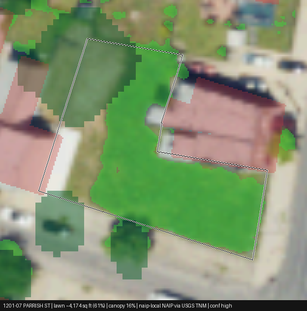
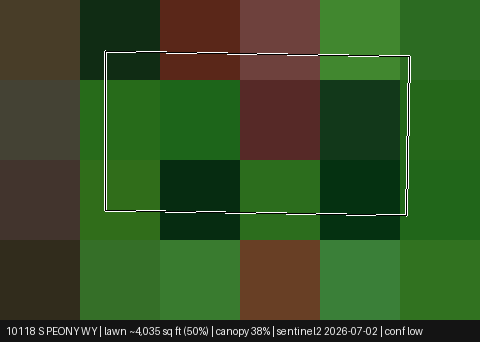
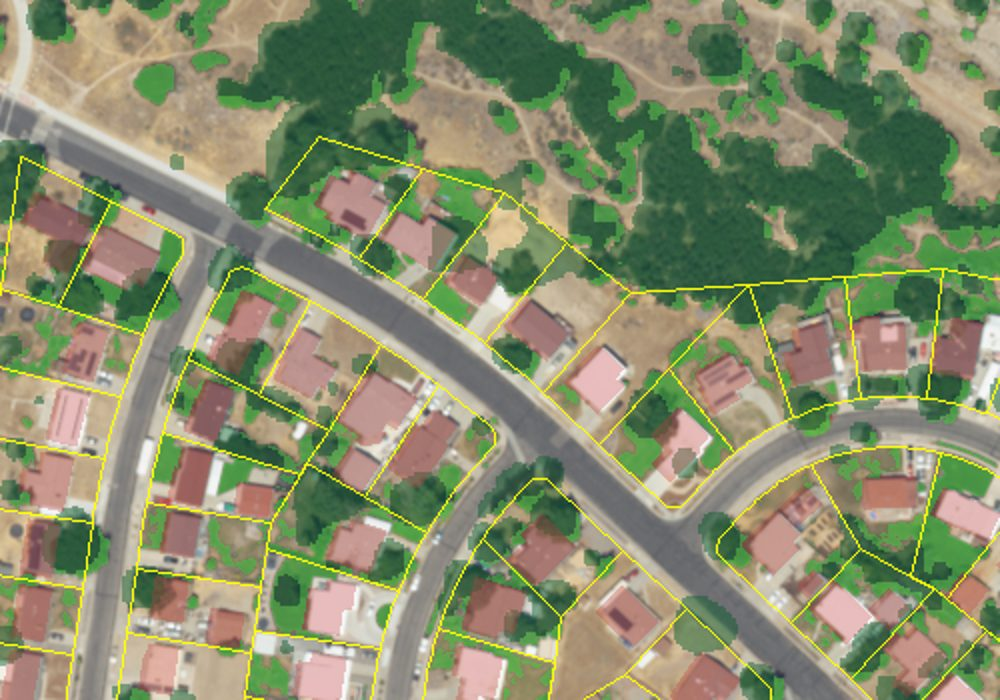
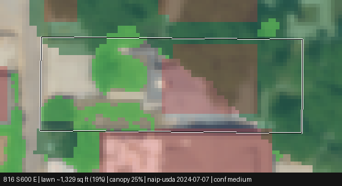
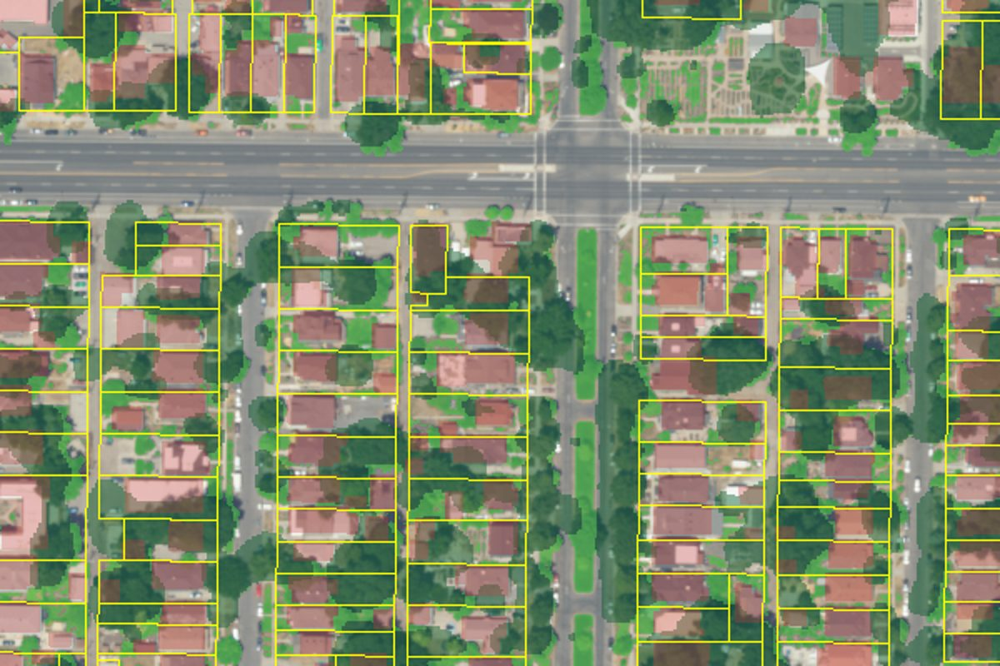

# Spike results (Phase 0)

Status as of 2026-10-27. Runs 1–2 were from a network-restricted sandbox; Runs 3–4 from a
Conductor cloud workspace with open network.

## TL;DR

* The lawn-detection pipeline (parcels → building footprints → 4-band NAIP → NDVI → canopy
  removal → per-parcel lawn sq ft + overlay PNG) **runs end to end on real 60 cm Utah NAIP**.
* **Imagery is 2024 NAIP, flown 2024-07-07**, pulled from USDA FPAC's `conus_naip` ImageServer
  (`--imagery usda`, now the default). Planetary Computer and USGS only carry Utah through 2021,
  and **Utah 2021 NAIP was flown in November** (leaf-off trees, dormant lawns): unusable for
  lawn. 2018 (Aug 28 / Sep 9) is the newest summer scene on Planetary Computer.
* 2024 NAIP is hazy; raw-DN NDVI put only 16% of pixels over 0.30 vs 46% in 2018 on the same
  blocks. **Dark-object subtraction** (0.1th percentile per band, uint8 NAIP only) brings 2024
  to 37% and moves 2018 only to 43%, so the 0.30 threshold carries over.
* **Sandy at 60 cm: 10.7 lawn acres** across the 415 residential parcels fully inside the bbox
  (range 8.9–12.6), median 906 sq ft of lawn per parcel. Sentinel-2 said 33.2 acres for the same
  415 parcels (39.8 for all 497 incl. edge parcels); at 60 cm it is clear
  that many Sandy back yards are dry, native scrub, or xeriscape, and that 10 m pixels mixed
  lawn with trees and dirt. Treat Run 2 as superseded.
* **Adam's neighborhood (84102) at 60 cm: 7.6 lawn acres** across 547 UGRC parcels, 35% of
  pixels under ≥2.5 m canopy. **816 S 600 E: 1,329 sq ft lawn** (range 1,025–1,595) plus
  **1,757 sq ft under trees**, on a 6,997 sq ft lot. Park strip is outside the parcel.
* **Validation against Adam's hand-measured lot: still not done** (needs the tape number).
  Expect the under-canopy share to dominate the error on this lot.

## What is proven

| Step | Data | Status |
|---|---|---|
| Parcels (Utah) | Sandy City mirror of SLCo Recorder parcels, 106k features, LIR attributes (`prop_location`, `Property_Type_Desc`, `year_built`, `total_sq_ft`, values). Extent: Sandy/Draper/Midvale/Cottonwood Heights. Fabric dated July 2022. | Working (public S3) |
| Parcels (UGRC LIR) | `services1.arcgis.com/.../Parcels_SaltLake_LIR/FeatureServer/0` (the old `Utah_Salt_Lake_County_Parcels_LIR` URL was wrong). Field names match the `ugrc_lir` map; `PARCEL_CITY` is also available. | Working (`--parcels ugrc`) |
| Building footprints | Overture Maps 2026-10-21 release, bbox pushdown via pyarrow | Working (public S3, ~30 s per neighborhood) |
| Tree canopy | Meta CHM v2 (1.19 m, DINOv3), windowed COG reads | Working (public S3) |
| NAIP 4-band, 60 cm, **2024** | USDA FPAC `apps.geo.fpac.usda.gov/geo-imagery/rest/services/naip/conus_naip/ImageServer` (`exportImage`, UTM 12N, 0.6 m) | **Working; default** (`--imagery usda`). Utah tiles dated 2024-07-07 |
| NAIP 4-band, 60 cm, ≤2021 | Planetary Computer STAC (`naip`) | Working (`--imagery pc`), but Utah stops at 2021 (November, leaf-off). Use `--naip-year 2018` for a summer scene |
| NAIP 4-band, 60 cm | USGS `USGSNAIPImagery` ImageServer | Reachable; Utah is 2021 only (acquisition 2021-11-05/13) |
| NAIP 2024, UGRC | `raster.utah.gov` (RGB and IR split; MrSID county mosaics) | Not needed given the USDA service |
| NAIP 4-band, 30 cm (resampled) | USGS TNM mosaic of Philadelphia on Source Cooperative | Working; used for code-path validation |
| Sentinel-2 L2A, 10 m | AWS `sentinel-cogs`, cloud check via SCL band | Working; fallback only |
| NDVI threshold + per-parcel accounting | numpy/rasterio, parcels rasterised to a label grid | Working |
| Overlay PNG per parcel + neighborhood PNG | Pillow | Working |

## Run 1: Philadelphia, real NAIP + real parcels (code-path validation)

`python -m pipeline.run_spike --bbox -75.165 39.962 -75.155 39.97 --parcels dor_parcel.parquet --buildings li_building_footprints.parquet --imagery philly_naip_mosaic.tif`

| Metric | Value |
|---|---|
| Parcels | 1,940 |
| Imagery | 4-band NAIP, 0.23 m (TNM mosaic, EPSG:3857) |
| Canopy ≥ 2.5 m | 10.4% of pixels |
| High/medium confidence parcels | 1,573 (81%) |
| Total lawn | 9.3 acres (range 7–11 at NDVI ±0.05) |
| Runtime | 12 s to classify; overlays dominate at ~0.1 s each |

Visual check of overlays (in `docs/spike/`): turf is tinted, roofs and parking are not, trees
are separated from lawn by the canopy model, parcel outlines line up with the imagery.



## Run 2: Sandy, Utah, real parcels + Sentinel-2 fallback

`python -m pipeline.run_spike --bbox -111.875 40.565 -111.865 40.573 --parcels sandy --imagery sentinel2`

| Metric | Value |
|---|---|
| Parcels (residential, 0.02–3 acres) | 497 |
| Footprints | 556 (Overture) |
| Imagery | Sentinel-2 `S2A_12TVL_20260702`, 10 m, 0% cloud over bbox |
| Canopy ≥ 2.5 m | 21.3% of pixels |
| Median lawn fraction | 0.375 |
| Median lawn per parcel | 3,361 sq ft |
| Total lawn | 39.8 acres (range 38.5–46.2) |
| Confidence | all `low` (parcel is ~8 pixels) |

Sanity check: 497 lots × ~0.2 acre = ~100 acres of parcel; ~40 acres of lawn (40%) with ~24%
building footprint and ~18% canopy is in the expected range for 1970s–90s Sandy subdivisions.
Treat as indicative only until the same bbox is run at 60 cm.



## Run 3: Sandy, Utah, 2024 NAIP 60 cm (supersedes Run 2)

`scripts/build-data.sh sandy` (= `run_spike --bbox -111.875 40.565 -111.865 40.573 --parcels sandy --imagery usda`)

| Metric | Value |
|---|---|
| Parcels (residential, 0.02–3 acres, wholly inside bbox) | 415 (82 edge parcels dropped) |
| Imagery | NAIP 2024 via USDA, 2024-07-07, 0.6 m, haze-corrected NDVI |
| Canopy ≥ 2.5 m | 23.6% of pixels |
| Confidence | 365 high, 45 medium, 5 low |
| Median lawn per parcel | 906 sq ft (median parcel 8,354 sq ft, median canopy 1,588 sq ft) |
| Total lawn | 10.7 acres (range 8.9–12.6 at NDVI ±0.05) |
| Lawn + canopy | 28.2 acres (upper bound if every tree stands over grass) |
| Water | 28 af/yr turf need, ~8 af/yr overwatering at 0.75 ft, 20 af/yr if all converted |

Same 415 parcels under Run 2 (Sentinel-2): 33.2 acres, median 3,390 sq ft. The drop is real, not a bug: see `docs/spike/sandy_naip2024_neighborhood.jpg`.
Back yards along the open-space gully are dirt/scrub, many lots have brown or xeriscaped
yards in July 2024, and 10 m pixels blended lawn with canopy.



## Run 4: Salt Lake City 84102 (Adam's block), 2024 NAIP 60 cm, UGRC parcels

`scripts/build-data.sh home` (= `run_spike --center -111.87428 40.75143 --radius-m 400 --parcels ugrc --imagery usda --address "816 S 600 E"`)

| Metric | Value |
|---|---|
| Parcels | 547 wholly inside the AOI (81 edge parcels dropped); UGRC Salt Lake County LIR, `PROP_CLASS = Residential` |
| Footprints | 964 (Overture) |
| Canopy ≥ 2.5 m | 34.8% of pixels |
| Confidence | 523 high, 24 medium, 0 low |
| Median lawn per parcel | 371 sq ft (median parcel 4,839 sq ft, median canopy 1,202 sq ft) |
| Total lawn | 7.6 acres (range 6.8–8.6); lawn + canopy 26.1 acres |
| Water | 20 af/yr turf need, ~6 af/yr overwatering, 14 af/yr if all converted |

**816 S 600 E** (parcel 16072770170000, 6,997 sq ft, built 1898):

| Class | sq ft |
|---|---|
| Lawn (NDVI > 0.30, not building, not canopy) | **1,329** (range 1,025–1,595) |
| Under tree canopy ≥ 2.5 m | 1,757 |
| Green upper bound (lawn + green under canopy) | 2,578 |
| Building (Overture + 0.5 m buffer) | 1,980 |
| Other (paving, beds, dry) | 1,931 |

Numbers to compare to the tape: `lawn_sqft` 1,329, `green_sqft` 2,578, `lawn + canopy` 3,086.
The park strip on 600 E is public right-of-way and is **not** in the parcel; it is visibly
irrigated turf in the imagery and would need a separate right-of-way polygon to be counted.




## NAIP year and haze notes

* Utah NAIP years on Planetary Computer: 2011, 2014, 2016 (1 m), 2018, 2021 (60 cm). The 2021
  items are dated 2021-11-05 / 2021-11-13 and USGS's catalog confirms those as acquisition dates.
  Leaf-off: trees are bare, lawns read weakly (NDVI p90 0.26). `docs/spike/naip2021_leaf_off_vs_cir.jpg`.
  Leaf-off imagery could be useful later for grass *under* deciduous trees, but shadows are long.
* USDA's `conus_naip` service always serves the newest year per state; when Utah 2026 lands
  it will switch silently. `summary.json` records the quarter-quad names and flight dates.
* NDVI statistics on the same 84102 blocks (raw DN → after dark-object subtraction):
  2024 share > 0.30: 16% → 37%; 2018: 46% → 43%.

## Known confounders (noted, not solved)

* Tree canopy over lawn: removed by the CHM, which also removes any turf under trees. Reported
  separately as `canopy_sqft`; `green_sqft` is the upper bound including canopy.
* Dormant or brown lawn reads as non-lawn. NAIP Utah is flown June–August; still a risk in
  drought years. `lawn_lo_sqft` / `lawn_hi_sqft` give the ±0.05 NDVI sensitivity.
* Artificial turf reads as non-lawn (correct for water, wrong for "is it grass").
* Building footprints are buffered 0.5 m to swallow eaves. Overture misses some sheds.
* Imagery date vs parcel fabric date: Sandy parcels are a July 2022 extract; NAIP 2024.
* Web Mercator inputs: areas come from parcel geometry in UTM 12N, fractions from pixels, so
  the 3857 Philadelphia mosaic does not inflate areas.

## Reproducing

```
scripts/setup.sh                       # venv + npm ci + datasets if missing
scripts/build-data.sh [sandy|home]     # rerun a neighborhood and copy it into the app
TRUTH_SQFT=<tape> scripts/build-data.sh home   # adds a validation block for 816 S 600 E
```

Any other address: `python -m pipeline.run_spike --center <lon> <lat> --radius-m 400 --parcels ugrc
--out data/out/<name> --address "<house number + street>" --truth-sqft <measured>`. `--parcels
ugrc` only covers Salt Lake County; other counties have `Parcels_<County>_LIR` services under
the same UGRC ArcGIS org (not wired up).

## Outputs

* `results.csv`: one row per parcel: `parcel_id, address, parcel_sqft, lawn_sqft, lawn_lo_sqft,
  lawn_hi_sqft, canopy_sqft, building_sqft, hardscape_other_sqft, confidence, imagery_source,
  imagery_date, gsd_m`.
* `overlays/<parcel_id>.png`, `neighborhood.png`, `summary.json`, optional `ndvi.tif` /
  `classes.tif`.

## Phase 1: water math (done, tested)

`pipeline/water.py` (pure functions, 15 tests in `pipeline/tests`), `pipeline/savings.py`
(three-layer card + district totals), `pipeline/eto_table.py` (monthly ETo from gridMET).

* **Reference ET**: FAO-56 Penman-Monteith (short reference) computed daily from gridMET
  (Climatology Lab, CC0; via the Fused H3 mirror on Source Cooperative) for the Sandy H3 cell,
  2023–2025 average. Wind assumed 2 m/s because the mirror omits it. Result:
  54.0 in/yr, July 9.1 in; Hargreaves cross-check 48 in/yr. Table in
  `pipeline/data/eto_sandy_ut.json`. Unit test reproduces FAO-56 Example 18 to ±0.15 mm/day.
* **Turf need** = ETo × Kc(0.80, cool-season turf) − 50% of monthly rain, Apr–Oct. For the
  median Sandy parcel (3,361 sq ft lawn): 31.6 in/season = ~66,000 gal/yr.
* **Bill**: outdoor = monthly use − winter (Dec–Feb) baseline. Units are taken from the bill
  (gal, kgal, CCF supported), never assumed.
* **Example card** (synthetic SLC-style bill peaking at 32 CCF in July): overwatering
  16,000 gal/yr (24% over need), rebate "up to" $5,041 at $1.50/sq ft (verified rate for Sandy
  and SLC is now $3.00), conversion
  46,500 gal/yr at a 0.30 water-wise coefficient.
* **District framing** for the Sandy test area (Run 3, 60 cm, 415 parcels): 10.7 lawn acres,
  28 acre-ft/yr turf need, ~8 acre-ft/yr overwatering at the DWR 0.5–1 ft midpoint, 20
  acre-ft/yr if all converted. (Run 2 at 10 m said 39.8 / 105 / 30 / 74; superseded.)

## Next

See `HANDOFF.md`. Main open item: Adam's tape measurement for 816 S 600 E.

## Phase 2: demo app (SvelteKit on Cloudflare Workers)

`app/`. Runs against static exports from the pipeline (`data/out/<run>/app/` copied to
`app/static/data/<dataset>/` by `scripts/build-data.sh`). Datasets: `sandy`, `home` (84102). No external tile server: the parcel view uses the pipeline's own
imagery crop as the base, so it works offline and never leaks the address to a map provider.

* `/` address search over the neighborhood, headline totals.
* `/p/<dataset>/<parcel>` tap-to-cycle correction map (lawn → not lawn → converted → trees;
  buildings fixed), live sq ft, three-layer savings card, rebate warning, water bill upload
  (vision model via `/api/bill`, falls back to manual 12-month entry) with units taken from the
  bill.
* `/district/<dataset>` lawn-share heat map aggregated by parcel, acre-feet totals.
* Corrections POST to `/api/labels` (D1 when bound, `schema.sql`), mirrored in localStorage so
  the demo works without a database.
* Rebate numbers come from the saved `rebate_programs.json` (no live lookups), resolved by city.
  Verified 2026-10-27: Sandy and SLC → CUWCD standard $3.00/sq ft, $50k cap; JVWCD cities $3.00;
  CUWCD rural $1.50; statewide track $2.00.

Run locally: `cd app && npm install && npm run dev`. Deploy: `npm run build && npx wrangler deploy`
after creating the D1 database named in `wrangler.jsonc` and setting `ANTHROPIC_API_KEY` as a
Worker secret.
